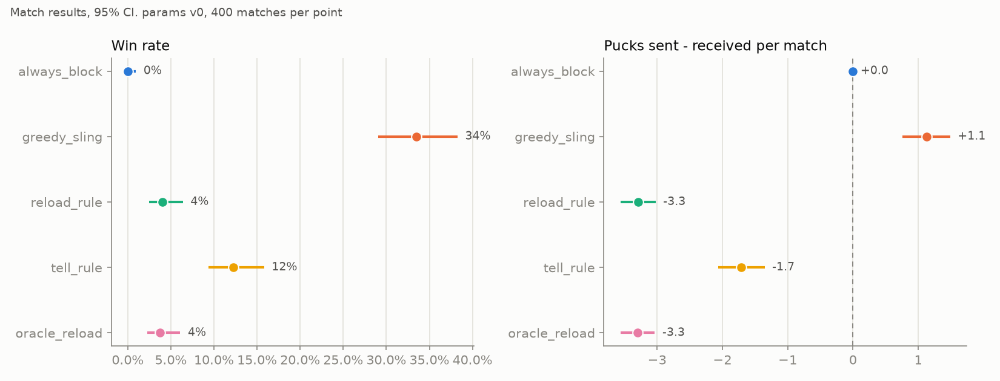
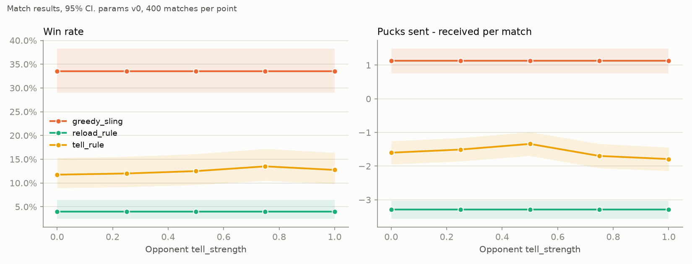

# slingpuck

An **SO-101 arm** (6-DOF, LeRobot-compatible, Feetech STS3215 servos) plays
tabletop **sling puck** against a human, on a **moopok Fast Sling Puck board,
size M**. Deployment inference must run on a Jetson Orin Nano.

**Research question:** *when is it safe to commit to a sling?* A sling takes the
arm away from the gate, so the gate is open until the arm comes back. A
high-level policy chooses **block**, **sling** or **hold** against the opponent.

---

## Contents

1. [Status](#status)
2. [Setup](#setup)
3. [Quick start](#quick-start)
4. [Repository layout](#repository-layout)
5. [Board frame and geometry](#board-frame-and-geometry)
6. [Configs and parameter versioning](#configs-and-parameter-versioning)
7. [The match](#the-match)
8. [MuJoCo match](#mujoco-match)
9. [Tests](#tests)
10. [Reproducibility](#reproducibility)
11. [Known problems and open items](#known-problems-and-open-items)
12. [Values to measure on the real hardware](#values-to-measure-on-the-real-hardware)

---

## Status

| Milestone | Content | Status |
|---|---|---|
| M4 | Opponent model, event-level match env, primitives, rule-based baselines, match eval, MuJoCo match | Done. Waits for review |
| M5 | Selector training, ablations, vulnerability window, ONNX export, latency benchmark | Not started (`deploy/` has the export and benchmark scripts only) |

The earlier goalkeeper (Phase 1), targeted shot (Phase 2), system
identification and digital twin code is not on this branch. It is on `main`
(up to commit `0221bb5`).

---

## Setup

Requirements: Python 3.10 or later. The project was tested with Python 3.14
(miniconda). Everything runs on CPU.

```bash
pip install -e ".[dev]"
pytest -q            # 49 tests, about 10 s
```

**Run all commands from the project root folder**, in the form
`python -m src.slingpuck.<module>`. The code imports the package as
`src.slingpuck`, so it works without `pip install -e .`.

Main dependencies: Gymnasium, NumPy, SciPy, PyTorch, Stable-Baselines3,
PyYAML, Matplotlib, Pillow (GIF output), MuJoCo 3.x.

**MuJoCo live window on macOS:** the MuJoCo viewer window must run under
`mjpython` (installed with MuJoCo), not `python`. GIF output works with any Python.

---

## Quick start

```bash
# Scripted selectors against the scripted opponent (event-level match)
python -m src.slingpuck.eval.match_eval
python -m src.slingpuck.eval.match_eval --policies greedy_sling reload_rule tell_rule --tell 0 0.5 1
python -m src.slingpuck.eval.match_eval --no-hand            # ablation: the policy does not see the hand

# MuJoCo match: the SO-101 (black pucks) against a scripted human (white pucks), face to face
mjpython -m src.slingpuck.eval.view_mujoco_match                                     # live 3D window
mjpython -m src.slingpuck.eval.view_mujoco_match --camera opponent                   # the human's view
mjpython -m src.slingpuck.eval.view_mujoco_match --games 0 --speed 0.5               # until the window closes, half speed
python   -m src.slingpuck.eval.view_mujoco_match --save match.gif --max-time 20       # GIF

# The full scene only (table, board, robot, 10 pucks)
python -m src.slingpuck.so101_slingpuck               # interactive viewer (Ctrl + right drag flicks a puck)
python -m src.slingpuck.so101_slingpuck --no-viewer   # build and check only
python -m src.slingpuck.so101_slingpuck --save        # write assets/mujoco/robotstudio_so101/so101_slingpuck.xml
```

---

## Repository layout

```
configs/
  physics_params_v0.yaml   Measured physics, version 0 (uncalibrated). Calibrated values go in v1, v2, ...
  env.yaml                 Sim timing, opponent, match timings and primitives, scoring
assets/
  mujoco/robotstudio_so101/  SO-101 MuJoCo model (RobotStudio MJCF, STS3215 actuators)
  urdf/so101.urdf          SO-101 URDF (not used)
src/slingpuck/
  config.py                Config loader, params versioning, placeholders, strict mode, run records
  so101_slingpuck.py       The full scene (table, board, bands, robot, 10 pucks): viewer, --save, --no-viewer
  physics/
    band_model.py          Pre-stretched band: V geometry, nonlinear tension, closed hysteresis loop, release
    mujoco_match.py        MuJoCo match: SO-101 (black pucks) against a scripted human (white pucks), all pucks in the physics
  envs/
    match_env.py           Event-level match (block / sling / hold over frozen primitives)
    wrappers.py            PrivilegedObsWrapper (Dict obs for the asymmetric critic)
  opponent/
    scripted_opponent.py   Human-like opponent: reload, place, pull, hold, release; hand trajectory; tell
  primitives/
    block.py               Block primitive: save probability from the arm's return time and the puck's arrival time
    sling.py               Sling primitive: timings and success probability
  policies/
    asymmetric.py          AsymmetricActorCriticPolicy for SB3 PPO (for the M5 selector)
    match_scripted.py      AlwaysBlock, GreedySling, ReloadRule, TellRule, OracleReload
  train/
    common.py              Match env factory, run loader, shared PPO runner and CLI, outcome logging
  eval/
    match_eval.py          Win/loss, puck difference, tell sweep, hand ablation
    stats.py               Wilson and Student-t confidence intervals
    view_mujoco_match.py   3D MuJoCo match viewer (cameras: overview, opponent)
  deploy/                  ONNX export and latency benchmark of a selector (M5)
tests/                     pytest suite
docs/figures/              Figures used in this README
logs/, tensorboard_logs/, results/   Training runs and eval outputs (not in git)
```

---

## Board frame and geometry

**Frame:** the origin is at the board center. x is across the board width, and y
is along the board length. The **agent's half is y < 0**, the **opponent's half
is y > 0**, and the center divider with the gate is at y = 0.

**Reference board:** moopok Fast Sling Puck, size M
([Amazon B086KWXPTY](https://www.amazon.com/moopok-Fast-Sling-Puck-Game/dp/B086KWXPTY/?th=1)).
Each value in `configs/physics_params_v0.yaml` has a source tag:

| Tag | Meaning |
|---|---|
| `[spec]` | From the size M listing text |
| `[image]` | From the listing image. The image shows size S, and we assume that size M is the same |
| `[user]` | Measured or estimated by the user |
| `[derived]` | Computed from other tagged values |
| `TODO` | Unknown. Must be measured |

| Quantity | Value | Source |
|---|---|---|
| Outer length × width × height | 0.3658 × 0.2159 × 0.0249 m (14.4 × 8.5 × 0.98 in) | spec |
| Frame (wall) thickness | 0.01524 m (0.6 in) | image |
| Inner play area | 0.3353 × 0.1854 m | derived |
| Gate width | 0.034 m | user: measured 3.4 cm |
| Divider thickness | 0.010 m | TODO |
| Puck diameter × thickness | 0.0254 × 0.0102 m (1 × 0.4 in) | user (diameter), image (thickness) |
| Puck mass | 0.027 kg | user. See the note below |
| Band anchor span | 0.1854 m (assumed to span the inner width) | derived |
| Band distance from the end wall | 0.05 m | TODO |

**Note on the puck mass:** 27 g in a 1 × 0.4 in puck gives a density of
5.2 g/cm³. Wood is 0.5 to 0.75 g/cm³. 27 g / 6 = 4.5 g, which is the expected
mass of one wood puck. Weigh one puck alone to confirm. The mass changes the
launch speed in the MuJoCo match.

**Note on the gate:** a straight shot goes through the gate when its launch x is
within ±(gate width / 2 − puck radius) = ±4.3 mm of the center
(`opponent.scripted_opponent.threat_half_width`). The opponent aims its threats
inside this band and its misses at least 6 mm off center.

---

## Configs and parameter versioning

### Merge order

`load_config(params_version)` merges two files. The later file overrides the
earlier one, key by key:

1. `physics_params_v<N>.yaml`
2. `env.yaml`

```python
from src.slingpuck.config import load_config, save_run_config
cfg = load_config("latest")          # or "v0", 0, "v3"
cfg["meta"]                          # params_version, params_file, calibrated, placeholders, git_hash, git_dirty
```

### Versioned physics parameters

- Put calibrated values in a new file `physics_params_v<N+1>.yaml`.
- `"latest"` loads the highest version. The loader checks that the `version:`
  field in the file matches the file name.
- Each training run records the params version that it used.

### Placeholders and strict mode

- Every value that is not measured has a `TODO` comment. In
  `physics_params_v0.yaml`, each one is also listed under `placeholders:` (16 now).
- `load_config(..., strict=True)` raises `ConfigError` while any placeholder or
  null value remains. Use strict mode for every result that you report against
  real data. Training accepts `--strict`.
- The match timings, the primitive values and the scoring rules in `env.yaml`
  are also placeholders (`TODO`), but strict mode does not check them.

---

## The match

### Design: an event-level match over frozen primitives

The selector needs millions of high-level decisions, so `envs/match_env.py` does
not simulate the puck and the arm at 1 kHz. It runs at 10 ms steps and uses:

- **Opponent shots:** straight flights with Coulomb friction (analytic arrival
  time at the gate). A pre-stretched band launches almost straight
  (`tests/test_band.py`), so the launch x decides whether a shot is a threat.
- **Block primitive** (`primitives/block.py`): the robot guards the gate with its
  closed gripper. A threat is saved if the gripper covers the gate before the
  puck gets there:

  ```
  time_to_cover = (time the puck reaches the gate) - (time the arm got back to the gate)
  p_save = block_save_prob * Phi((time_to_cover - cover_time_s) / cover_time_std_s)
  ```

  Phi is the standard normal CDF. An arm that is away from the gate saves
  nothing. An arm that stayed at the gate saves with `block_save_prob`.
- **Sling primitive** (`primitives/sling.py`): fixed timings and a success
  probability (`sling_success_prob`).

All primitive values are placeholders in `env.yaml` (`match:`) until they are
measured on the robot. Speed: about 70,000 decisions per second (one process).

### Opponent (`opponent/scripted_opponent.py`)

- Cycle: **reload** (hand fetches a puck) → **place** (to the band) → **pull** (pull ~
  shot speed) → **hold** (random pause) → **release**, about 1.2 s per shot.
- The hand covers the loaded puck from the overhead camera. The camera sees the
  hand (position, velocity, 5 mm noise).
- **`tell_strength`:** during place, pull and hold, the hand x is
  `tell · x_launch + (1 − tell) · x_decoy`, with the decoy from the same
  distribution. 0 = the hand says nothing about the threat. 1 = the hand shows
  the launch x exactly (tested: correlation ~0 at 0, exact at 1).
- 50% of shots are threats (placeholder). The generator is seeded.

### Actions, arm states, observation, reward

| Action | Effect |
|---|---|
| 0 block | From the band: return to the gate (0.6 s). At the gate: stay; the block primitive defends |
| 1 sling | From the gate: move to the band (0.6 s), fetch the next puck (1.0 s), sling (0.9 s). From the band: fetch and sling. Ignored when busy or out of pucks |
| 2 hold | Keep the arm where it is (at the band: ready for another sling, gate open) |

Arm states: gate → to_band → slinging → at_band → to_gate → gate. The gate is
open from the sling command until the arm is back (the explicit recovery time).
After the return, the gripper needs `cover_time_s` to cover the gate.

- **Observation (20 values):** tracked incoming opponent puck (only after the
  camera latency), opponent hand (x, y, vx, vy), arm state (one-hot, time left,
  gate covered), puck counts, own puck in flight, time left.
  `match.observe_hand: false` sets the hand values to zero (the M5 ablation).
- **Privileged (critic only):** opponent phase, time to release, next shot
  (threat, x, speed), incoming threat and its time to the gate.
- **Reward (placeholder, `scoring`, TODO: real rules):** +1 per puck sent, −1 per
  puck received. The first side with no pucks wins (+5 / −5). 5 pucks per side,
  60 s limit.

### Baselines (`policies/match_scripted.py`) and results

```bash
python -m src.slingpuck.eval.match_eval [--policies ...] [--matches 400] [--tell 0 0.5 1] [--no-hand]
```

| Policy | Rule |
|---|---|
| `always_block` | Never slings |
| `greedy_sling` | Slings whenever possible, never returns |
| `reload_rule` | **The plan's baseline:** sling only when the opponent reloads (hand away from its band line); otherwise go back to the gate |
| `tell_rule` | Like `reload_rule`, but also slings while the opponent aims if the hand x shows a likely miss |
| `oracle_reload` | `reload_rule` with the opponent's true phase (privileged) |

The hand-based reload detector is reliable where it matters: it marks the
opponent as aiming in more than 98% of pull/hold frames (tested).



| Policy (400 matches, tell 0.8) | Win [95% CI] | Loss | Sent − received [95% CI] | Conceded while away |
|---|---|---|---|---|
| `always_block` | 0% [0, 1] | 0% | +0.0 | 0 / match |
| `greedy_sling` | 34% [29, 38] | 18% | +1.1 [+0.8, +1.5] | 20 / match |
| `tell_rule` | 12% [9, 16] | 44% | −1.7 [−2.1, −1.4] | 19 / match |
| `reload_rule` | 4% [3, 6] | 64% | −3.3 [−3.6, −3.0] | 17 / match |
| `oracle_reload` | 4% [2, 6] | 61% | −3.3 [−3.6, −3.0] | 17 / match |



### Findings (with placeholder timings and rules)

1. **The plan's baseline does badly.** A sling away from the gate takes about 3.1 s
   (out, fetch, sling, back). The opponent's reload is about 0.6 s. Thus "sling
   only while the opponent reloads" always leaves the gate open for the next
   2–3 shots. Even with the true phase (oracle), it loses most matches.
2. **The tell helps, but little.** `tell_rule` beats `reload_rule`, but its gain
   does not grow clearly with the tell. To know that the *current* shot is a
   miss protects only one of the ~2.5 shots that come during a sling.
3. **Under the "first empty side wins" rule, the match is a throughput race.**
   With the robot timings scaled ×0.5 (sling-and-return cycle 1.6 s), every
   strategy wins 100%. At the default 3.1 s, greedy slinging beats every
   defensive rule. Strategy is important only in a narrow band, where the
   robot's sling rate is close to the opponent's threat rate.

Thus the answer to the research question depends on values that are not
measured yet: **the real scoring rules**, the robot's fetch, sling, move and
cover times, and the human's cycle time and accuracy. M5 (selector training,
ablations, vulnerability window) must run after those values are known, or
over a sweep of them.

---

## MuJoCo match

`physics/mujoco_match.py` plays a full match in MuJoCo physics. The scene comes
from `so101_slingpuck.build`: the table, the board, both bands, 5 black robot
pucks and 5 white human pucks, and a simple mocap hand. All 10 pucks slide with
Coulomb friction and bounce off the walls, the divider and each other.

- **Scene frame:** the origin is at the robot base, x forward, y left, z up.
  The robot and the board stand on the same table. The board lies lengthwise and
  centered, with the robot behind the agent end wall. The human sits at the far
  end (camera `opponent`). One light from straight above.
- **Robot (scripted, the `reload_rule` idea):** the closed gripper stands in the
  gate. When the human reloads and a puck rests on the robot's half, the arm
  moves above it, grasps it (the jaws close on its sides), drags it to the band,
  pulls back 2.5 cm, holds, releases, and goes back to the gate. A fetch that has
  not grasped yet stops when the human starts to pull.
- **Human (scripted, timings and aim from `env.yaml` `opponent`):** reload, place
  on its band, pull back, hold, release.
- **Band:** a held puck behind its band line gets the band force (`BandModel`).
  A stiff connect constraint passes the force to the arm or the hand. On release,
  the unloading band pushes the puck to its band line, and then the puck keeps
  `energy_transfer` of its energy.
- **Contacts:** the gripper collision boxes touch the puck colliders. Puck
  collisions use a sphere of the puck radius at mid-height (MuJoCo's
  cylinder-box contact gives a wrong normal at the gate corners). Contact
  damping comes from `board.restitution`.

The MuJoCo match does not feed the event-level match. It is a check that the
scripted plan is physically possible with the SO-101 and the real board sizes.

---

## Tests

```bash
pytest -q
```

| File | What it checks |
|---|---|
| `test_config.py` | Version resolution, `latest`, version mismatch, strict mode, placeholders, run records |
| `test_stats.py` | Wilson and t intervals against known values |
| `test_band.py` | **Hysteresis loop closes** and loses the set fraction (3 exponents × 3 losses), monotonic tension, pre-tension, force direction, release energy balance, energy transfer, almost-straight launch, tiny pull does not launch |
| `test_match.py` | Opponent: tell 1 shows the launch x exactly, tell 0 hides it, threats aim inside the gate (width from the geometry), phases in order, smooth hand. Match: `check_env`, **pucks conserved**, rewards add up, a covered gate saves every threat, greedy concedes every threat while away, sling timing, seeded repeat, hand ablation, puck hidden before the camera latency, reload detection, block primitive values, a late return concedes, bad gate geometry rejected |
| `test_asymmetric_policy.py` | On the match env: the actor ignores privileged input, the critic uses it, save and load |
| `test_slingpuck_scene.py` | Board in front of the robot, turning axis matches the config, board and robot on the same table, flicked puck slows with Coulomb friction, wall bounce keeps the configured restitution, opponent camera faces the robot |
| `test_match_mujoco.py` | 5 black and 5 white pucks, both players shoot, no blow-up (speeds stay below 6 m/s, all pucks on the board), guard pose stands in the gate |

---

## Reproducibility

- The match env and the opponent use the Gymnasium `np_random` generator, so a
  match repeats exactly from its seed (tested).
- Training seeds PyTorch, NumPy and the envs (`set_random_seed`, PPO `seed`,
  `make_vec_env(seed=...)`).
- Each run saves the full merged config, the physics params version, the git
  hash and dirty flag, and the seed. Commit your changes before a run that you
  will report, so that `git_dirty` is false.
- The eval saves its own `eval_meta.yaml` with the same information.

---

## Known problems and open items

- **Fidelity:** block and sling outcomes come from simple primitive models, not
  physics. One opponent puck at a time is resolved at the gate. Puck-puck
  collisions in the gate are not modeled.
- The robot sling ignores where the agent's pucks lie (a fixed fetch time).
- The opponent never blocks, and its accuracy does not depend on the match state.
- The game balance depends on placeholder timings and rules (see the findings).
- **M5:** the selector training script, the vulnerability-window eval and the
  robot interface do not exist yet. `train/common.py` has the match env factory
  and the PPO runner. `deploy/export_onnx.py` exports an `MlpPolicy` only (not the
  asymmetric policy).

---

## Values to measure on the real hardware

| Value | Config path | Why it is important |
|---|---|---|
| **Game scoring rules** | `scoring` | Reward and win rule; decides whether the match is a throughput race |
| **Robot fetch, sling and move times** | `match.fetch_time_s`, `match.sling_core_s`, `match.move_*` | Length of the vulnerability window |
| **Gate cover time after a return, and its spread; block save rate** | `match.cover_time_s`, `match.cover_time_std_s`, `match.block_save_prob` | Block primitive |
| Robot sling success rate | `match.sling_success_prob` | Sling primitive |
| **Human opponent timing and accuracy** (video of human play) | `opponent.*` | Opponent cycle, threat rate, tell |
| Real shot speeds | `opponent.shot_speed_range_m_s` | Puck arrival time at the gate |
| Camera latency | `camera.latency_s` | When the robot sees an incoming puck |
| Divider thickness, wall height | `board.divider_thickness_m`, `board.wall_height_m` | Gate geometry, MuJoCo board |
| Puck mass (one puck alone), diameter in mm, thickness | `puck.mass_kg`, `puck.radius_m`, `puck.thickness_m` | Launch speed, all contacts, threat width |
| Sliding friction, wall restitution | `puck.friction_kinetic`, `board.restitution` | Puck flight and bounces |
| Band peg spacing, band distance from the end wall | `band.anchor_span_m`, `band.band_offset_from_end_wall_m` | Band geometry |
| Natural (unstretched) band length, band stiffness and hysteresis, energy transfer | `band.*` | Launch speed in the MuJoCo match |
| Arm base position | `robot.base_xy_m` | Scene layout and reach |
